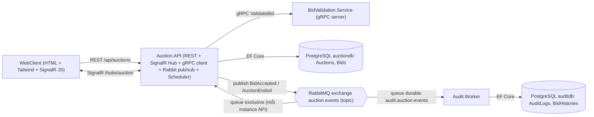
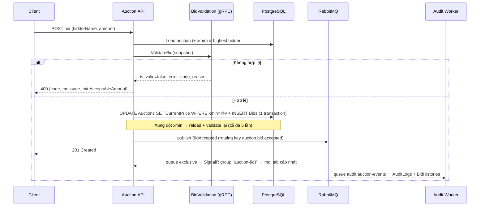

# 🔨 Online Auction System – Microservices & Event-Driven (.NET 8)

Hệ thống đấu giá trực tuyến realtime: **ASP.NET Core 8 · gRPC · RabbitMQ (Topic Exchange) · SignalR · PostgreSQL/EF Core · Docker Compose**.

---

## 1. Kiến trúc



| Project | Loại | Vai trò |
|---|---|---|
| `src/Auction.Contracts` | Class Library | `Protos/bid_validation.proto` (sinh code **Client + Server**), Event models `BidAcceptedEvent`, `AuctionEndedEvent`, `EventTopology`, `EventSerializer` |
| `src/BidValidation.Service` | ASP.NET Core gRPC (HTTP/2, cổng **5200**) | Stateless validate lượt trả giá: trạng thái phiên, `StartTime ≤ now < EndTime`, giá ≥ `CurrentPrice + MinStepPrice` (lượt đầu ≥ `StartingPrice`), người trả giá hợp lệ & không tự nâng giá chính mình |
| `src/Auction.API` | ASP.NET Core Web API (cổng **5100**) | REST, `AuctionHub` (SignalR), gRPC client, RabbitMQ publisher + consumer (đẩy SignalR), `AuctionLifecycleWorker` tự mở/đóng phiên, Optimistic Concurrency (`xmin`) |
| `src/Audit.Worker` | .NET Worker Service | Consumer queue bền vững, ghi `AuditLogs` (payload `jsonb`) và `BidHistories`, xử lý idempotent theo `EventId` |
| `src/WebClient` | ASP.NET Core static host (cổng **5300**) | `wwwroot/index.html` + `app.js` (TailwindCSS CDN + `@microsoft/signalr`) |

### Luồng đặt giá `POST /api/auctions/{id}/bids`



### Điểm thiết kế chính
- **Fanout qua Topic Exchange** `auction.events`: mỗi instance API có queue *exclusive/auto-delete* riêng (scale-out vẫn nhận đủ sự kiện), Audit có queue *durable* riêng. Publisher cũng khai báo queue audit ⇒ không mất sự kiện khi Audit.Worker chưa chạy.
- **Race condition**: cột hệ thống `xmin` của PostgreSQL làm concurrency token (`uint Version` + `IsRowVersion()`); cập nhật giá và insert bid nằm chung transaction. Xung đột ⇒ reload + **gọi lại gRPC** để validate với giá mới. Kết thúc phiên cũng thay đổi `xmin` ⇒ bid "đua" với lệnh kết thúc sẽ bị từ chối đúng.
- **Publisher Confirms** + message `persistent`; consumer **manual ack**; Audit **idempotent** (unique index `EventId`).
- **Tự động migration** khi khởi động (có retry chờ DB), DB `auditdb` được EF tự tạo.
- **Scheduler** (`AuctionLifecycleWorker`, quét mỗi 2s): `Pending → Active` khi tới giờ, tự kết thúc phiên hết giờ, chọn người trả giá cao nhất làm `WinnerId`.

---

## 2. Yêu cầu môi trường
- .NET SDK 8.0+ (SDK 9/10 cũng build được vì project target `net8.0`; cần **runtime .NET 8** để chạy).
- Docker Desktop (đã bật).
- Cổng trống: `5432, 5672, 15672, 5100, 5200, 5300`.

---

## 3. Cách chạy

### Cách A – Toàn bộ bằng Docker Compose (nhanh nhất)
```powershell
docker compose up -d --build
docker compose ps
docker compose logs -f auction-api audit-worker
```
| Thành phần | URL |
|---|---|
| WebClient | http://localhost:5300 |
| Swagger Auction.API | http://localhost:5100/swagger |
| RabbitMQ Management | http://localhost:15672 (user `auction` / pass `auction123`) |
| PostgreSQL | `localhost:5432` (user `auction` / pass `auction123`, DB `auctiondb`, `auditdb`) |
| gRPC BidValidation | `localhost:5200` (h2c, có Reflection) |

Dừng: `docker compose down` (thêm `-v` để xoá dữ liệu).

### Cách B – Chỉ chạy hạ tầng bằng Docker, services chạy bằng `dotnet run` (dễ debug)
```powershell
# 1. Hạ tầng
docker compose up -d postgres rabbitmq

# 2. Build solution
dotnet build OnlineAuction.sln

# 3. Mỗi lệnh chạy ở một terminal riêng (theo thứ tự)
dotnet run --project src/BidValidation.Service     # http://localhost:5200 (gRPC)
dotnet run --project src/Auction.API               # http://localhost:5100 (Swagger: /swagger)
dotnet run --project src/Audit.Worker
dotnet run --project src/WebClient                 # http://localhost:5300
```
> Có thể mở trực tiếp file `src/WebClient/wwwroot/index.html` bằng trình duyệt (mặc định gọi API `http://localhost:5100`, CORS đã cho phép).

### Migration (đã có sẵn trong repo, tự chạy khi khởi động)
```powershell
dotnet tool restore
dotnet ef migrations add <Name> -p src/Auction.API  -s src/Auction.API  -o Data/Migrations
dotnet ef migrations add <Name> -p src/Audit.Worker -s src/Audit.Worker -o Data/Migrations
```

---

## 4. REST API (`Auction.API`)

| Method | Route | Mô tả | Mã trả về |
|---|---|---|---|
| POST | `/api/auctions` | Tạo phiên | 201 / 400 |
| GET | `/api/auctions?status=Active` | Danh sách (lọc tuỳ chọn) | 200 |
| GET | `/api/auctions/{id}` | Chi tiết (giá hiện tại, trạng thái, `winnerId`, `minNextBid`, `highestBidder`) | 200 / 404 |
| POST | `/api/auctions/{id}/bids` | Đặt giá `{ bidderName, amount }` | 201 / 400 / 404 / 409 / 503 |
| GET | `/api/auctions/{id}/bids` | Lịch sử trả giá (mới nhất trước) | 200 / 404 |
| POST | `/api/auctions/{id}/end` | Kết thúc phiên thủ công | 200 / 404 / 409 |

Lỗi nghiệp vụ trả về dạng:
```json
{ "code": "AMOUNT_TOO_LOW", "message": "Giá đặt phải ≥ giá hiện tại (1.200.000) + bước giá (100.000) = 1.300.000.", "minAcceptableAmount": 1300000 }
```
Mã lỗi gRPC: `INVALID_BIDDER`, `AUCTION_ENDED`, `AUCTION_NOT_STARTED`, `AUCTION_EXPIRED`, `AUCTION_NOT_ACTIVE`, `INVALID_AMOUNT`, `ALREADY_HIGHEST_BIDDER`, `AMOUNT_TOO_LOW`. Ngoài ra: `AUCTION_NOT_FOUND` (404), `CONCURRENCY_CONFLICT` / `AUCTION_ALREADY_ENDED` (409), `BID_VALIDATION_UNAVAILABLE` (503).

### SignalR Hub `/hubs/auction`
| Hướng | Method | Ghi chú |
|---|---|---|
| Client → Server | `JoinAuctionGroup(auctionId)` / `LeaveAuctionGroup(auctionId)` | group `auction-{id}` |
| Server → Group | `BidAccepted(BidAcceptedEvent)`, `AuctionEnded(AuctionEndedEvent)` | phát từ consumer RabbitMQ |
| Server → All | `AuctionCreated`, `AuctionUpdated`, `AuctionStatusChanged` | cập nhật danh sách |

---

## 5. Kịch bản test A → Z

### Bước 1 – Khởi động & kiểm tra hạ tầng
1. `docker compose up -d --build` → `docker compose ps` thấy tất cả `running` (postgres/rabbitmq `healthy`).
2. Mở http://localhost:15672 → tab **Exchanges** có `auction.events` (type `topic`); tab **Queues** có `audit.auction-events` và một queue `amq.gen-...` (của Auction.API).

### Bước 2 – Realtime với 2 tab
1. Mở **Tab A**: http://localhost:5300 – góc phải hiển thị tên ngẫu nhiên (vd `User-AB12`), đổi thành `Alice`.
2. Mở **Tab B** (cửa sổ khác, đặt cạnh nhau): đổi tên thành `Bob`. (Tên lưu theo `sessionStorage` nên mỗi tab một người.)
3. Ở Tab A: tạo phiên "iPhone 16 Pro", giá khởi điểm `1.000.000`, bước giá `100.000`, bấm **5 phút** → **Tạo phiên**.
   ✅ Tab B thấy phiên mới xuất hiện ngay trong danh sách (sự kiện `AuctionCreated`).
4. Cả hai tab chọn phiên đó (join group SignalR).
5. Tab A đặt giá `1.000.000` → ✅ Tab B: giá nhảy (hiệu ứng nháy vàng), lịch sử thêm dòng, toast "Alice vừa trả ...".
6. Tab A bấm đặt giá tiếp → ❌ `400 ALREADY_HIGHEST_BIDDER`.
7. Tab B bấm **🧪 Thử giá thấp** → ❌ `400 AMOUNT_TOO_LOW` với lý do chi tiết từ gRPC.
8. Tab B bấm **+1 bước** → **Đặt giá** (`1.200.000`) → ✅ Tab A cập nhật tức thì.
9. Bấm **⏹ Kết thúc phiên** ở một tab → ✅ cả 2 tab hiển thị banner người thắng (`Bob`), tab của người thắng hiển thị "🎉 Chúc mừng!".

### Bước 3 – Tự động mở/đóng phiên (Background Service)
1. Tạo phiên có **Bắt đầu** = hiện tại + 1 phút, **Kết thúc** = hiện tại + 2 phút → trạng thái `Chờ mở`.
2. Đặt giá ngay → ❌ `400 AUCTION_NOT_STARTED`.
3. Chờ tới giờ → trạng thái tự chuyển `Đang diễn ra` (sự kiện `AuctionStatusChanged`). Đặt vài giá.
4. Hết giờ → phiên tự `Đã kết thúc`, người trả giá cao nhất là người thắng (log API: `ended by Scheduler`).
5. Đặt giá sau khi kết thúc → ❌ `400 AUCTION_ENDED`.

### Bước 4 – Test bằng REST (PowerShell)
```powershell
$api = "http://localhost:5100"
$start = (Get-Date).ToUniversalTime().ToString("o")
$end   = (Get-Date).ToUniversalTime().AddMinutes(10).ToString("o")

$a = Invoke-RestMethod -Method Post "$api/api/auctions" -ContentType "application/json" -Body (@{
  productName="MacBook Pro M4"; description="Hàng mới 100%"; startingPrice=30000000; minStepPrice=500000
  startTime=$start; endTime=$end } | ConvertTo-Json)
$a

# Bid hợp lệ
Invoke-RestMethod -Method Post "$api/api/auctions/$($a.id)/bids" -ContentType "application/json" `
  -Body (@{ bidderName="Alice"; amount=30000000 } | ConvertTo-Json)

# Bid không hợp lệ (thấp hơn giá + bước) -> 400
try {
  Invoke-RestMethod -Method Post "$api/api/auctions/$($a.id)/bids" -ContentType "application/json" `
    -Body (@{ bidderName="Bob"; amount=30100000 } | ConvertTo-Json)
} catch { $_.ErrorDetails.Message }

Invoke-RestMethod "$api/api/auctions/$($a.id)/bids"
Invoke-RestMethod -Method Post "$api/api/auctions/$($a.id)/end"
Invoke-RestMethod "$api/api/auctions/$($a.id)"     # status = Ended, winnerId = Alice
```
Tương đương với `curl`:
```bash
curl -X POST http://localhost:5100/api/auctions/{id}/bids -H "Content-Type: application/json" -d '{"bidderName":"Bob","amount":1500000}'
```

### Bước 5 – Kiểm chứng race condition
Tạo một phiên đang mở rồi chạy:
```powershell
./scripts/concurrent-bids.ps1 -AuctionId <id> -Count 20
```
Kỳ vọng: **đúng 1** request `201`, các request còn lại `400 AMOUNT_TOO_LOW` (sau khi xung đột `xmin` được phát hiện, API reload và gRPC validate lại với giá mới). Log API có dòng `Concurrency conflict ... retrying`. Giá cuối cùng và số lượt khớp tuyệt đối.

### Bước 6 – Kiểm tra Audit.Worker
```powershell
docker exec -it auction-postgres psql -U auction -d auditdb -c 'SELECT "EventType", "AuctionId", "Payload"->>''bidderName'' AS bidder, "Payload"->>''amount'' AS amount, "CreatedAt" FROM "AuditLogs" ORDER BY "CreatedAt" DESC LIMIT 10;'
docker exec -it auction-postgres psql -U auction -d auditdb -c 'SELECT "BidderName","Amount","PreviousPrice","BidAt" FROM "BidHistories" ORDER BY "BidAt" DESC LIMIT 10;'
docker exec -it auction-postgres psql -U auction -d auctiondb -c 'SELECT "ProductName","CurrentPrice","Status","WinnerId" FROM "Auctions";'
```
**Test độ bền của queue:** `docker compose stop audit-worker` → đặt vài giá → RabbitMQ UI thấy `audit.auction-events` có message *Ready* → `docker compose start audit-worker` → message được tiêu thụ hết và ghi đủ vào `AuditLogs`.

### Bước 7 – Test gRPC trực tiếp (tuỳ chọn, cần [grpcurl](https://github.com/fullstorydev/grpcurl))
```powershell
grpcurl -plaintext localhost:5200 list
grpcurl -plaintext -d '{\"auction_id\":\"3fa85f64-5717-4562-b3fc-2c963f66afa6\",\"status\":\"AUCTION_STATUS_ACTIVE\",\"start_time\":\"2020-01-01T00:00:00Z\",\"end_time\":\"2099-01-01T00:00:00Z\",\"starting_price\":{\"units\":100},\"current_price\":{\"units\":100},\"min_step_price\":{\"units\":10},\"has_bids\":true,\"current_highest_bidder\":\"Alice\",\"bidder_name\":\"Bob\",\"amount\":{\"units\":105}}' localhost:5200 auction.validation.v1.BidValidator/ValidateBid
```
→ `isValid: false`, `errorCode: AMOUNT_TOO_LOW`.

### Bước 8 – Khả năng chịu lỗi
- `docker compose stop bid-validation` → đặt giá trả `503 BID_VALIDATION_UNAVAILABLE`; start lại là hoạt động bình thường.
- `docker compose restart rabbitmq` → API & Worker tự kết nối lại (Automatic Recovery), WebClient tự reconnect SignalR.

---

## 6. Cấu trúc thư mục
```
OnlineAuction.sln
docker-compose.yml
dotnet-tools.json               # dotnet-ef 8.0.10
scripts/concurrent-bids.ps1
src/
├─ Auction.Contracts/           Protos/bid_validation.proto, Events/*
├─ BidValidation.Service/       Services/BidValidatorService.cs, Validation/BidRules.cs
├─ Auction.API/                 Controllers/, Data/ (+Migrations), Entities/, Grpc/, Hubs/, Messaging/, Services/
├─ Audit.Worker/                Data/ (+Migrations), Entities/, Messaging/AuditEventConsumer.cs
└─ WebClient/                   wwwroot/index.html, wwwroot/app.js
```

## 7. Hướng mở rộng cho production
- **Transactional Outbox** để đảm bảo publish sự kiện khi DB đã commit (hiện tại publish ngay sau commit, lỗi publish chỉ được log).
- **Redis backplane** cho SignalR nếu scale nhiều instance (sự kiện RabbitMQ đã đến mọi instance; riêng `AuctionCreated/StatusChanged` đang gửi trực tiếp từ instance xử lý).
- Xác thực JWT (dùng `UserId` thay cho `BidderName`), rate limiting cho endpoint đặt giá, OpenTelemetry tracing xuyên REST → gRPC → RabbitMQ.
